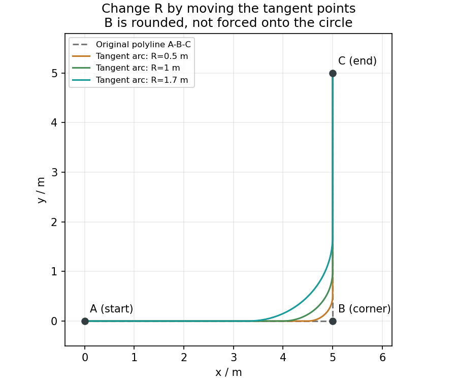
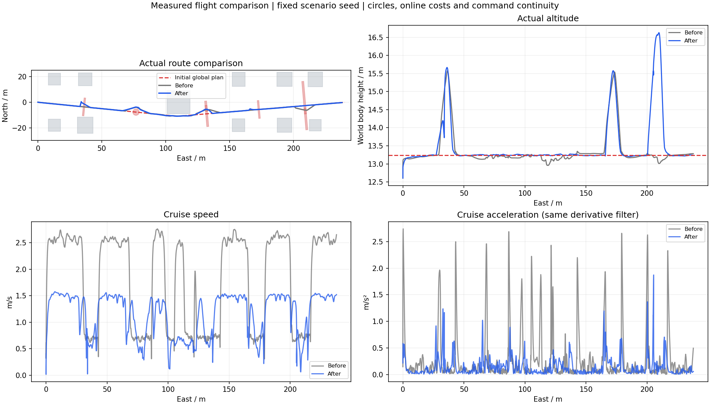

# 在线代价比较与圆弧平滑

基准为用户完整飞行 `runs/20261117_170106_399660_city_300_0`。
任务送达，254.019 s、实际三维航程 274.837 m、最小包络净空 0.536 m、落点误差 0.658 m。
本次工作不修改该运行的源码快照、结果或原始轨迹。

## 发现

最后一道低矮宽墙前（195.6 s），旧模型将 SIDE_RIGHT 计为 20.184，OVER 计为 26.654；
207.5 s 检测开口后将通过开口的路线标为 PASS。旧值是加权几何评分，不是实测秒数。
评分包含 1.7 倍爬升距离、未观测比例和净空惩罚，但没有完整反映转弯减速的时间。
同时，旧选择器会保留可行同侧路线，排除可行且更便宜的 OVER 候选。
巡航与避障的前视距离分别为 3 m、0.8 m，切换还会造成位置指令突变。

## 新的比较口径

每次比较基于同一观测地图、同一起点和回归点，对全部可行候选及当前路线重新计价：

```text
J = 预测运动时间 + 入口速度方向调整时间
  + 2.0 × 低净空暴露时间 + 1.5 × 最大净空不足比例²
  + 0.35 × 未观测暴露时间
  + 0.03 × 侧向偏离积分
  + 路线切换代价
```

预测运动时间使用统一的水平 1.8 m/s、竖直 1 m/s 名义上限，纵向加速度 1 m/s²、
横向加速度 0.8 m/s²；按照每条路线的长度、坡度和曲率做加减速约束。
另用 `sqrt(2 × 0.4 × max(d − 0.9, 0.01))` 限制贴近障碍时的速度，
其中 d 是当前观测点净空，0.4 m/s² 是保守接近减速度；候选计时与实际控制共用该包络。
这是考虑外层位置跟踪滞后的提前减速规则，不是对实际动力学的形式化停止保证。
入口调整时间依据 MAVROS 估计速度与候选入口方向的差值计算。
净空、未知及切换权重仍是明确公开的启发式权重，不宣称等于真实能耗或全局最优时间。
策略标签不参与运动时间计算，也没有“这种障碍必须穿洞”的规则。

切换到新路线加 1 s 等效代价；跨到相反侧额外加 2 s。
当前路线安全时，候选需改善至少 1.5 s 或 10%，并跨两份地图持续 1 s 才替换。
当前路线失效时继续保留执行前碰撞检查；任意旧路线缺失后，改换通道均需
跨至少 3 份观测且持续 1.5 s 确认，包括旧路线为 OVER 的情况。
OVER 可以替换可行 PASS，PASS 也可以替换可行 OVER，均由回归检查覆盖。
`events.jsonl` 的 `candidate_comparison` 逐项记录所有评分分量及保留/切换原因。

## 圆弧的几何与边界

三个固定且不共线的点决定唯一的圆，曲率不能在保持三个点都不动时任意调整。
这里把折线中点 B 作为待圆滑的拐角，而不是强制经过的圆上点；
根据半径 R 移动切入点和切出点，使圆弧与前后线段相切。



```text
转向角 θ = acos(u·v)
切入/切出到拐角的距离 d = R tan(θ/2)
曲率 κ = 1/R
转弯速度上限 v = sqrt(a_lat R)
```

名义半径最多 2 m，另受相邻线段长度限制；依次尝试更小半径并检查整段弧线与连接线。
删点及圆弧检查的净空取原始搜索路线的最小净空（扣除 0.03 m 采样余量），
上限为偏好净空 1.6 m，下限为既有 1.05 m 路径检查门槛；
避免删点把 A* 已买到的转弯余量削掉。
不安全时保留原安全折线并依曲率降速。三维圆弧位于局部三个点定义的平面中，
因此水平侧绕和竖直越障都能处理；近共线和反向点单独处理，避免不稳定的大圆。
圆弧与直线是切线连续（G1），不是曲率连续（G2）；曲率跳变不能靠“三点圆”自动消失。

正常重规划保留约 2 m 的已验证安全前缀，候选接在前缀之后，避免立即改向。
速度渐变滤波器内部限制加速度和 jerk，最终输出沿当前安全路径方向投影，
避免把旧路径的方向滞后带到新路径外；曲率限速用于提前减速。
最终空间指令向量不等同于严格 jerk 受限的全局轨迹优化。
速度预览覆盖前方 1.8 m；实际追踪距离随弯道限速缩短到 0.5–1.8 m，避免紧弯抄角。
保留当前路线只需验证近 0.5 m 的可见性，实际发送的整段指令仍逐帧检查；
较远的瞬时未观测不会立刻触发改换路线。危险、未观测或陈旧输入触发制动时，安全优先。`command_trace.csv` 保存实际发送的目标点。

## 验证记录

第一轮开发验证 `20261117_172632_592845_city_300_0` 未通过：虽然飞过五处障碍，
但过于频繁的早期换路和指令滞后导致反复制动；近回归点的诊断缺省字段还触发异常。
该运行及失败账本全部保留。后续加入安全前缀、相切圆弧及近目标诊断回归。

`20261117_173450_341392_city_300_0` 飞过五处障碍，但终点只剩单航点时错误地将
限速设为零，无法修正过冲，停滞保护降落；已增加单终点纠偏回归。
`20261117_174043_073841_city_300_0` 暴露密集采样导致游标滞后、冻结前缀倒向的问题，
已改为等弧长采样、几何最近点跟踪和前缀方向检查。
`20261117_174700_135900_city_300_0` 是后续开发中主动中止的运行，未计为成功。
`20261117_175257_318305_city_300_0` 首次在该分支完整送达：292.797 s、
最小净空 0.454 m、落点误差 0.643 m，无包络侵入。加速度和 jerk 下降，但转向总量
增加、出现 12 次执行制动与 4 次净空恢复；不能因此宣称总体平滑已改善。
`20261117_180242_725699_city_300_0` 在前视修正后送达：303.686 s，
加速度 P95 0.660 m/s²、jerk P95 1.444 m/s³、转向总量 763.3°；
仍有 7 次制动、1 次恢复，尚未解决跟踪惯性进入边缘的问题。
`20261117_180820_057283_city_300_0` 加入保留净空的平滑后，仍在圆柱旁进入执行
安全余量边缘，停滞保护降落，未送达。未降低执行检查阈值；进一步加入上述提前减速包络。
完整修正版复核结果如下。
对比脚本 `scripts/compare_trajectories.py` 仅离线读取独立真值；
巡航段重采样到 10 Hz，以 1.1 s 三次 Savitzky–Golay 窗口计算导数，
统一比较转向总量、95 分位加速度/jerk、近悬停时间与沿东向倒飞距离。
这些数据不会回流规划器，不能混入控制输入。

## 冻结修正版实飞：20261117_181309_618846_city_300_0

41 项检查通过，完整 PX4 SITL 送达、降落并锁定；独立评测有效，无机体包络侵入。
该轮源码快照与当时冻结版本一致，是后续修正的基线；方向限速与原航线合流的
后续改动在实飞中变差已回退，见 `MOTION_RETURN_UPDATE.md`。与用户原飞行的障碍、起终点几何一致。
这是“在线统一代价 + 圆弧 + 前缀衔接 + 更保守速度”的整体对比，
不能把减小加速度的全部收益归因于圆弧，也不能称为单变量消融或大样本送达率。

| 指标 | 用户原飞行 | 修正版 |
|---|---:|---:|
| 完整任务时间 / s | 254.019 | 334.659 |
| 实际三维航程 / m，含起降 | 274.837 | 281.786 |
| 最小机体包络净空 / m | 0.536 | 0.707 |
| 落点平面误差 / m | 0.658 | 0.646 |
| 巡航加速度 P95 / m/s² | 1.402 | 0.583 |
| 巡航 jerk P95 / m/s³ | 3.163 | 1.114 |
| 移动时转向总量 / ° | 920.9 | 876.5 |
| 巡航低于 0.2 m/s 的时间 / s | 0.0 | 17.7 |
| 东向累计倒飞 / m | 0.001 | 0.371 |
| 新路线下发次数 | 12 | 43 |
| 执行制动事件 | 0 | 2 |
| 净空恢复 / 全局重规划 | 0 / 0 | 0 / 0 |

两次执行制动原因均为规划等待，并非占据碰撞检查失败。
加速度 P95 降低约 58%，jerk P95 降低约 65%；耗时增加约 32%。
转向总量仅小幅降低，路线下发与低速等待仍多，不能描述成“消除了所有抖动”或“最快路径”。
真实限制包括传感器开口证据时变、候选暂时失效与外层位置跟踪误差。
名义速度模型仍未做大样本时间标定，加权秒仅用于执行前相对比较。

在线选择证据：226.121 s，第二道低墙前 OVER 的加权代价 14.47，
可行当前 SIDE_LEFT 为 27.42；跨观测确认收益后实际改为越过。
263.214 s，末道带洞低墙前同时存在 OVER 和 PASS：新 OVER 为 17.79，
两条 PASS 分别为 22.07 / 23.10；保留 OVER 路线（20.74）等待新路线收益确认。
这些是当时观测下的预测评分，不是两条未同时执行路线的事后实测耗时。

[完整运行结果](runs/20261117_181309_618846_city_300_0/result.json) ·
[完整事件与评分](runs/20261117_181309_618846_city_300_0/events.jsonl) ·
[对比指标 JSON](docs/trajectory_comparison.json)



复现：

```bash
cd ~/urban_drone_demo
bash scripts/check.sh
bash scripts/demo.sh --case city_300 --keep-open
```

重新生成离线对比：

```bash
source scripts/env.sh
python3 scripts/compare_trajectories.py \
  runs/20261117_170106_399660_city_300_0 \
  runs/20261117_181309_618846_city_300_0 \
  --output docs/trajectory_comparison.png
```

后续方向限速、统一偏离权重与原航线合流变更已在实飞中变差并回退，
其记录见 [MOTION_RETURN_UPDATE.md](MOTION_RETURN_UPDATE.md)。
本文数字均属于对应历史运行，不是新改动的完整验收结果。

最新重复后撤的恢复衔接修正见 [RECOVERY_RESUME_FIX.md](RECOVERY_RESUME_FIX.md)，尚待用户实飞。
